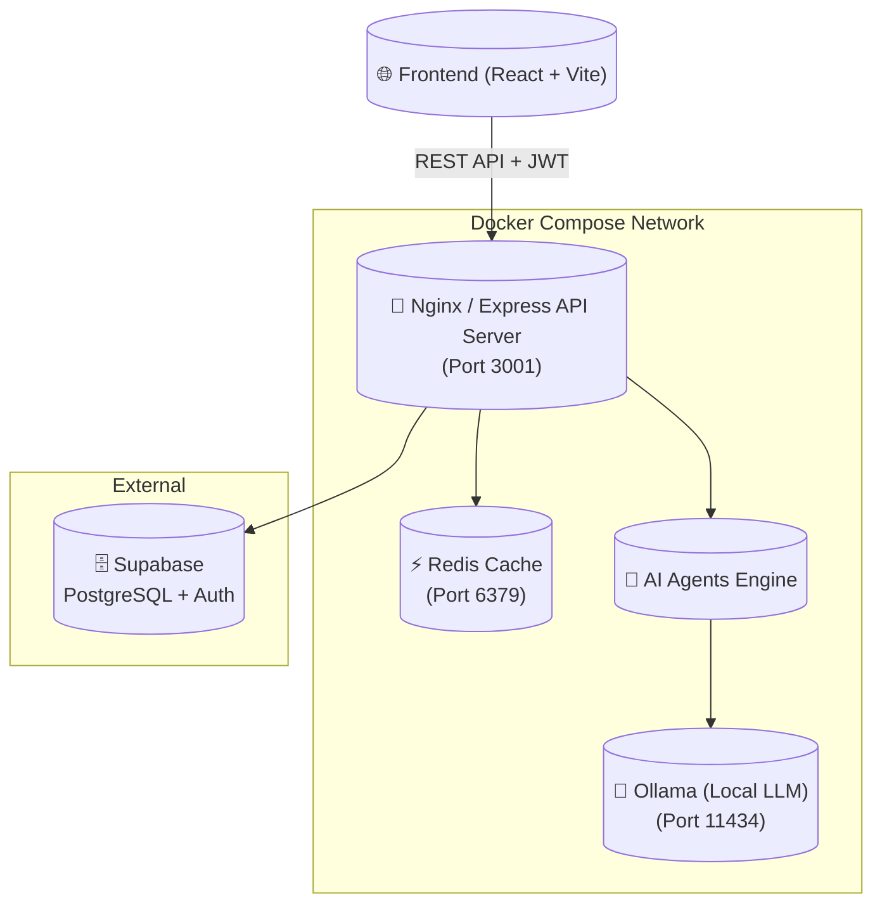
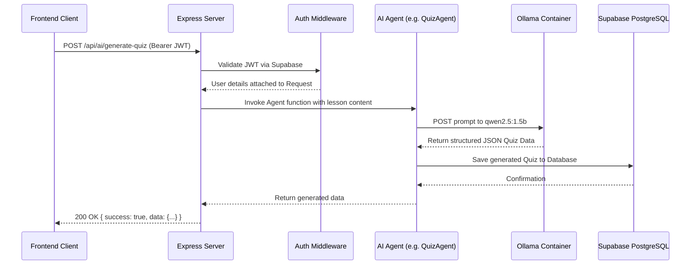
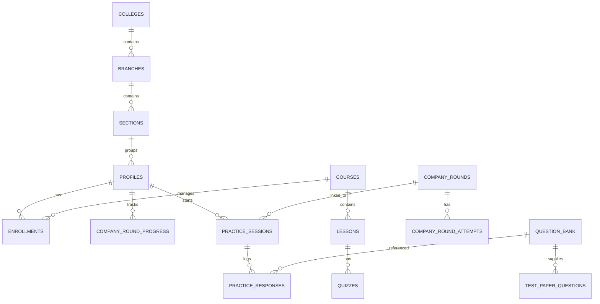

# Orbivex EdTech Platform Architecture

> **Version:** 3.1
> **Last Updated:** 2026-04-30

## 1. High-Level System Architecture

Orbivex is a self-hosted, AI-first EdTech platform designed for institutional scalability (Colleges > Branches > Sections > Students). The application utilizes a monolithic Node.js API backend and a Vite+React frontend. All AI interactions occur via local LLM instances deployed via Docker (Ollama), bypassing external API costs and ensuring data privacy.

## 2. Frontend Architecture
The frontend is a single-page application built with React 18, utilizing Vite for fast HMR and optimized builds. 
- **State Management:** Uses **Zustand** for lightweight, boilerplate-free state (Auth, Courses, UI context).
- **Styling:** Vanilla CSS with custom CSS variables (`--brand-500` is the primary vivid orange `#f97316`). Avoids utility frameworks in favor of deep structural control and glassmorphic premium design aesthetics.
- **Routing:** React Router v6 mapping to role-based components (Student vs. Educator vs. Admin views).
- **Animations:** Framer Motion for micro-interactions, page transitions, and staggered list renders. Three.js (React Three Fiber) is utilized for 3D hero rendering (`OrbitalScene`), now featuring a realistic, noise-distorted rolling solar surface matching the brand palette.

## 3. Backend & API Flow
The API is built on **Node.js + Express** and operates within a Docker container (`orbivex-api`). All responses are formatted uniformly in JSON: `{ "success": boolean, "data": {}, "error": string }`.

### Typical API Request Lifecycle

### Core API Scopes
- **`/api/auth`**: Supabase Auth wrapper (Login, Signup, User Profile).
- **`/api/courses` & `/api/lessons`**: Learning content delivery, enrollment, and progress tracking. Role-based RLS limits access via the `course_access` system.
- **`/api/admin`**: Full platform control (requires Admin role) for Colleges, Users, Jobs, and Bulk Data operations.
- **`/api/ai`**: Direct interface to AI functionalities.

## 4. AI Agents Engine
AI capabilities are modularized inside `backend/agents/`. Each agent dynamically interfaces with the local Ollama instance over the Docker network.
- **`quizAgent.js`**: Generates MCQ quizzes from raw course/lesson texts.
- **`courseGeneratorAgent.js`**: Drafts full course outlines from a single user prompt.
- **`gradingAgent.js`**: Compares student responses against rubrics.
- **`plagiarismAgent.js`**: Verifies text originality.
- **`recommendAgent.js`**: Computes next best actions for users based on progress.

## 5. Database Schema (Supabase PostgreSQL)
The database serves as the source of truth for organization structure, user records, caching, and content. It heavily utilizes PostgreSQL's JSONB for flexible schema designs (e.g., Question Banks, Round Topics, AI Responses).

### Major Schema Modules
1. **Multi-Tenant Model:** `colleges` -> `branches` -> `sections`. `profiles` are linked to a specific section.
2. **Access Control (`course_access`):** Restricts course visibility to specific branches or sections dynamically.
3. **Company Prep & Paced Learning Ecosystem (v3.1):** 
   - `company_rounds`: Defines rounds for placement preparation.
   - `company_round_progress`: State machine tracking a student's unlock status for sequential rounds.
   - `practice_sessions` & `practice_responses`: Logs real-time test behavior.
   - `company_round_attempts`: Multiple timed test-paper attempts.
   - `topic_notes`: Server-side JSONB caching for computationally expensive AI-generated study material per `(company_slug, round_index, topic)`. It includes a `pace_level` (1-5) column so each topic can hold up to 5 AI-generated variants, allowing students to pick their desired learning pace.

## 6. Infrastructure & Deployment
The system relies exclusively on a unified `docker-compose.yml` for orchestration.
- **Networking:** Applications communicate internally on `orbivex-net`.
- **Compute constraints:** `qwen2.5:1.5b` model is set as the default to ensure functionality across environments constrained to under 4 GiB of RAM.
- **Storage:** Static assets (videos, avatars) are hosted on Supabase Storage.
